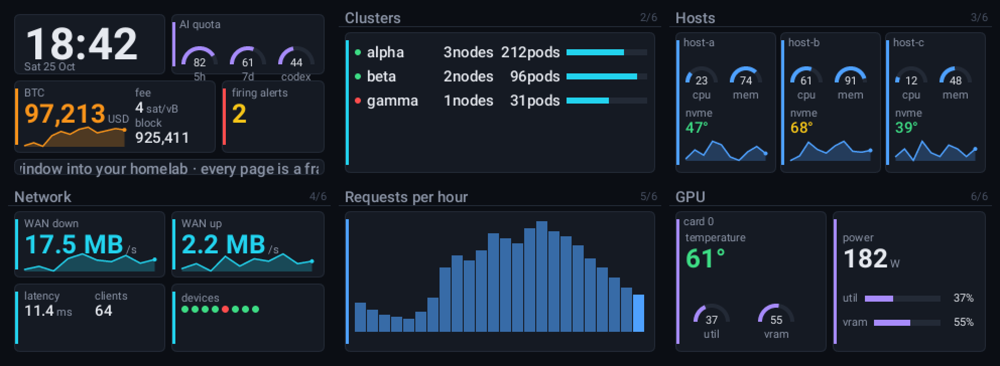

# Peephole

**A tiny window into your homelab.** Peephole renders dashboard pages for small ESP32 screens: a Rust hub polls your sources through plugins, draws every page as a frame, and the boards show the frames. The same frames appear in your browser, and the hub's flash page programs new boards over USB from the browser.

> Status: v0.1, built in a day for one board (LilyGo T-Display-S3, 320×170). It works; expect sharp edges. v0.2 adds a settings panel, per-device page lists and an optional API token.



## Why a hub

An ESP32 cannot load code at runtime and should not hold the credentials of your cluster. So the board is a thin client: it fetches `GET /frame.png?id=<mac>&w=320&h=170` every few seconds and tells the hub when a button is pressed. Everything else (plugins, credentials, rendering, the web UI, the flash page) lives in one small Rust binary. Any display ESPHome drives can be a client at its own resolution, and the public demo is the same hub with synthetic data.

## Try it in two minutes

```bash
PEEPHOLE_DEMO=1 cargo run -p peephole-hub --release
# or
docker run --rm -p 8080:8080 -e PEEPHOLE_DEMO=1 ghcr.io/giovannirco/peephole:latest
```
Open http://localhost:8080/ : every page of `examples/demo.yaml`, refreshing every five seconds.

## Your own pages

1. Copy `examples/homelab.yaml` (thirteen pages fed by Prometheus and a mempool API) or start from `examples/demo.yaml`.
2. Point the plugins at your sources with environment variables (`${PROMETHEUS_URL}`, `${MEMPOOL_URL}`, …). The hub refuses to start when one is missing.
3. Run it: `PEEPHOLE_CONFIG=my.yaml peephole`.
4. Flash a board from `https://<hub>/flash/` (Chrome or Edge; WebSerial needs HTTPS), give it Wi-Fi when asked, open the board's own page and set the hub URL.

### Configuration

```yaml
hub: {title: Homelab, cycle_s: 12, stale_s: 600}
plugins:
  - kind: clock
    tz: ${PEEPHOLE_TZ:-UTC}
  - kind: prometheus
    name: p
    url: ${PROMETHEUS_URL}
    queries:
      - {key: mem, expr: '1 - node_memory_MemAvailable_bytes / node_memory_MemTotal_bytes', label: instance}
pages:
  - name: hosts
    cards:
      - {x: 6, y: 24, w: 308, h: 140, accent: web, widgets: [
          {kind: rows, x: 8, y: 6, w: 290, items: [{key: host-a}, {key: host-b}],
           cols: [{kind: name, w: 80}, {kind: bar, bind: "p/mem/{}", w: 180, thresholds: {warn: 0.8, bad: 0.9}}]}]}
```
Values live in a store under `plugin/key[/label]`; widgets bind to keys. Widgets: `kpi`, `gauge`, `hbar`, `spark`, `bars`, `text`, `rows`, `dots`, `ticker`, `image`. Colours are tokens (`bitcoin`, `web`, `ai`, `net`, `ok`, `warn`, `bad`, `text`, `text2`, `muted`) or `#RRGGBB`. Thresholds colour a value `ok`/`warn`/`bad` (`invert: true` when lower is worse).

| Variable | Meaning |
|---|---|
| `PEEPHOLE_CONFIG` | path of the YAML (required unless demo) |
| `PEEPHOLE_LISTEN` | `0.0.0.0:8080` |
| `PEEPHOLE_DEMO` | `1`: only `clock` and `demo` plugins may run, every action is refused |
| `PEEPHOLE_STATE` | JSON file that remembers devices across restarts |
| `PEEPHOLE_FIRMWARE_DIR` | directory of `<board>-<version>.factory.bin` files for the flash page |
| `PEEPHOLE_PUBLIC_URL` | the URL boards should use, shown on the flash page |
| `PEEPHOLE_API_TOKEN` | when set, every `POST` needs `Authorization: Bearer <token>` (401 otherwise); reads stay open |
| `RUST_LOG` | `info` |

### Settings panel

`/settings` shows how the hub is configured: the hub fields and which variable sets each, which `PEEPHOLE_*` variables are set (never their values), and per plugin its interval, last poll, value count, error and settings as written. A `${VAR}` reads `env VAR · set`; values under keys that look secret (`key`, `token`, `password`, `auth`, `headers`, …) read `••••`; URLs lose their userinfo. Edit the YAML or the environment and restart to change any of that; the panel only edits devices: name, cycle, page and **page list** (the pages a board steps and cycles through, in order; none ticked = every page; a plugin event can still show any page). "Poll now" polls a plugin at once.

### HTTP

| Route | |
|---|---|
| `GET /frame.png?id&w&h`, `GET /pages/{name}.png?w&h` | frames |
| `GET /api/pages`, `/api/devices`, `/api/devices/{id}`, `/api/values`, `/api/config` | read |
| `GET /api/plugins` | per plugin: `name`, `kind`, `interval_s`, `ok`, `error`, `polled_at`, `age_s`, `values` |
| `GET /api/settings` | `hub`, `plugins` (with redacted `settings`), `devices`, `pages` |
| `POST /api/devices/{id}/next`, `prev`, `page {name}`, `message {text}`, `name {name}`, `cycle {cycle_s}` | device actions |
| `POST /api/devices/{id}/pages {"pages": ["a", "b"]}` | page list (`[]` = every page; 400 on unknown names) |
| `POST /api/plugins/{name}/poll` | poll now: 202 `{"polled": name}`, 404 if unknown |
| `GET /settings`, `/flash/`, `/healthz` | settings panel, flash page, liveness |

## Plugins

| Kind | What it gives | Needs |
|---|---|---|
| `clock` | `time`, `date`, `weekday`, `hour`, `epoch` | a timezone |
| `demo` | the numbers and series you list, wobbling a little | nothing |
| `prometheus` | instant queries as numbers (one per label value), range queries as series | a Prometheus-compatible API (Prometheus, Mimir, Thanos, VictoriaMetrics) |
| `http_json` | numbers and text picked from any JSON endpoint by JSON pointer | a URL |
| `mempool` | BTC price, tip height, fees, mempool, difficulty, hashrate, a 24 h price series | a mempool.space-compatible API |
| `unifi_protect` | cameras online, snapshots as images, ring/motion events that bring a page to the front | a UniFi Protect console and an API key |

Writing one is a Rust trait with two methods; see [docs/plugins.md](docs/plugins.md). Most ideas do not need code: a `prometheus` or `http_json` recipe in YAML plus a screenshot is a welcome pull request.

## Firmware

`firmware/esphome/` holds one ESPHome configuration per board. CI compiles them into factory images that the hub serves on `/flash/`. The firmware carries no credentials: Wi-Fi comes over Improv during flashing, the hub URL is a setting on the board's web page. See [firmware/esphome/README.md](firmware/esphome/README.md).

## Design

[docs/design.md](docs/design.md): why a hub, the value and page model, the HTTP contract, what is deliberately out of scope.

## License

MIT. Roboto is bundled under the Apache License 2.0.
